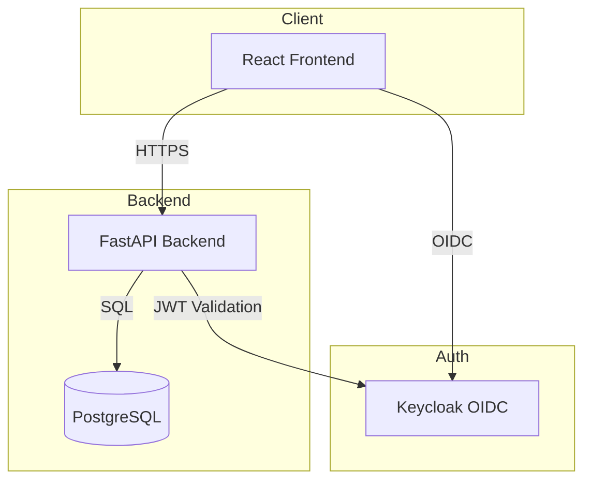

# Lumen Hub

> Work in progress. This checkpoint may be incomplete or fail tests. See PLAN.md and STATUS.md before use.


AI/ML Developer Platform for managing PostgreSQL projects with integrated authentication, SMS OTP templates, and health monitoring.

## Overview

Lumen Hub is a developer platform that provides a unified interface for managing PostgreSQL-based applications with built-in authentication, SMS OTP template management (supporting WebOTP API), project health monitoring, and SMTP configuration for email delivery.

**Author:** Ryan Vo (ryandtvo@gmail.com) | AI & Machine Learning

## Features

- **Authentication**: OIDC/OAuth2 with Keycloak, supporting SAML identity brokering
- **SMS OTP Templates**: Full CRUD with newline support for WebOTP API compliance (Issue #6435)
- **Project Health Monitoring**: Detects and auto-resolves PostgREST schema issues (Issue #40617)
- **SMTP Configuration**: Office 365/Outlook compatible with TLS 1.2+ (Issue #34425)
- **Dashboard**: Real-time service health and quick actions

## Architecture



## Quick Start

### Prerequisites

- Docker & Docker Compose
- Node.js 24+ (for frontend development)
- Python 3.12+ (for backend development)

### Using Docker Compose (Recommended)

```bash
# Clone and navigate
cd lumen-hub-ryan-vo

# Copy environment file
cp .env.example .env

# Start all services
docker compose up -d

# Access services
# Frontend: http://localhost:5173
# Backend API: http://localhost:8000
# Keycloak Admin: http://localhost:8080 (admin/admin)
```

### Local Development

#### Backend

```bash
cd backend

# Create virtual environment
python -m venv .venv
source .venv/bin/activate

# Install dependencies
pip install -r requirements.txt

# Run development server
uvicorn app.main:app --reload --host 0.0.0.0 --port 8000
```

#### Frontend

```bash
cd frontend

# Install dependencies
npm install

# Run development server
npm run dev
```

## Testing

### Backend Tests

```bash
cd backend
source .venv/bin/activate
python -m pytest tests/ -v
```

### Frontend Tests

```bash
cd frontend
npm test
```

### Full CI Pipeline

```bash
# From repository root
docker compose -f docker-compose.yaml up -d
# Run tests against running services
cd backend && .venv/bin/pytest tests/
cd ../frontend && npm test && npm run build
```

## API Reference

### Health Endpoints

| Method | Endpoint | Description |
|--------|----------|-------------|
| GET | `/api/v1/health` | Basic health check |
| GET | `/api/v1/health/ready` | Readiness check (dependencies) |
| GET | `/api/v1/health/live` | Liveness check |

### Authentication (Planned)

| Method | Endpoint | Description |
|--------|----------|-------------|
| POST | `/api/v1/auth/login` | Username/password login |
| POST | `/api/v1/auth/token` | Exchange code for tokens |
| POST | `/api/v1/auth/refresh` | Refresh access token |
| POST | `/api/v1/auth/logout` | Logout |

### SMS Templates (Planned)

| Method | Endpoint | Description |
|--------|----------|-------------|
| GET | `/api/v1/sms/templates` | List templates |
| POST | `/api/v1/sms/templates` | Create template |
| GET | `/api/v1/sms/templates/{id}` | Get template |
| PUT | `/api/v1/sms/templates/{id}` | Update template |
| DELETE | `/api/v1/sms/templates/{id}` | Delete template |
| POST | `/api/v1/sms/templates/{id}/test` | Send test SMS |

### Projects (Planned)

| Method | Endpoint | Description |
|--------|----------|-------------|
| GET | `/api/v1/projects` | List projects |
| POST | `/api/v1/projects` | Create project |
| GET | `/api/v1/projects/{id}` | Get project |
| GET | `/api/v1/projects/{id}/health` | Project health status |

## Security

- **Authentication**: OIDC Authorization Code with PKCE
- **Tokens**: JWT with RS256, validated against Keycloak JWKS
- **Sessions**: HttpOnly SameSite cookies (backend) / Memory-only (SPA)
- **CORS**: Configurable origins, credentials allowed
- **Secrets**: Never committed, loaded from environment
- **Demo Mode**: Explicitly enabled, refuses to start in production

## Configuration

### Environment Variables

See `.env.example` for all available options.

### Keycloak Setup

1. Access Keycloak Admin Console at `http://localhost:8080`
2. Login with `admin` / `admin`
3. Realm `lumen-hub` is pre-configured with:
   - `lumen-hub-backend` (confidential client)
   - `lumen-hub-frontend` (public client with PKCE)
   - Roles: `admin`, `operator`, `user`

### SAML Identity Brokering

Keycloak supports upstream SAML IdPs through identity brokering:
1. Configure SAML IdP in Keycloak Admin Console
2. Map SAML attributes to Keycloak roles
3. Users can then authenticate via SAML

## Deployment

### TLS Reverse Proxy Requirements

- Terminate TLS at reverse proxy (nginx, Traefik, Caddy)
- Forward `X-Forwarded-Proto`, `X-Forwarded-For` headers
- Ensure Keycloak `KC_HOSTNAME` matches public hostname

### Backup/Restore

```bash
# Backup PostgreSQL
docker exec lumen-hub-postgres pg_dump -U postgres lumen_hub > backup.sql

# Restore
docker exec -i lumen-hub-postgres psql -U postgres lumen_hub < backup.sql
```

## License

MIT License - Copyright (c) 2024 Ryan Vo <ryandtvo@gmail.com>